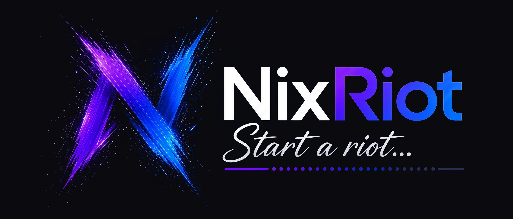
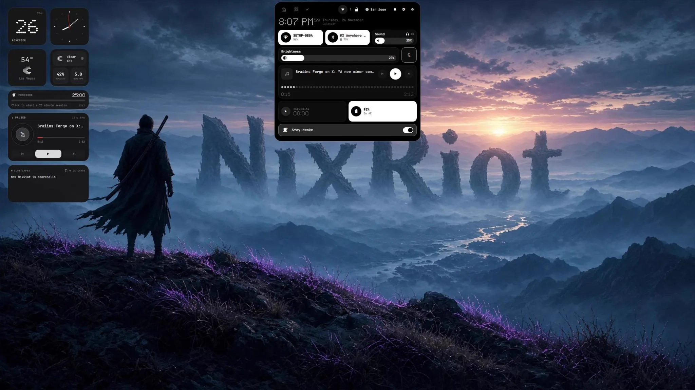
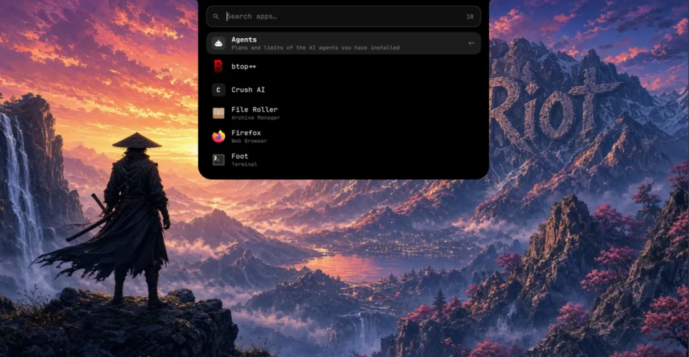
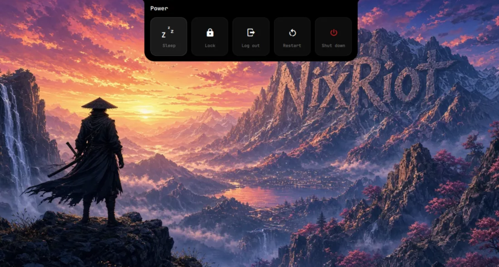

<div align="center">




[](#donations)

</div>

## Status of NixRiot

**This is an early alpha. It has not been fully tested on real hardware, so
parts of it may not work at all. Download and install it at your own risk.**

What is verified, in a virtual machine only:

- The image builds, installs over the network with LUKS, and reboots.
- It comes up on the Panacea desktop.

What has not been tested:

- A full install on real hardware.
- The lock screen and the password vault.
- Media keys and the pill's media capsule.
- Bluetooth, and the Mullvad app under Wayland.
- Unverified claims under [Supported hardware](#supported-hardware).



## Philosophy of NixRiot

NixRiot is a small, fast, reproducible desktop, assembled from things we learned
the hard way.

ArchRiot was the first pass: Arch, an installer, and hand-maintained dotfiles. It
taught us what the desktop should feel like. Omarchy then covered much of that
ground, so we stopped rather than duplicate it. What we could not fix on Arch was
trust: the AUR means running code from strangers, and that is not a defensible
default for a desktop you have to keep patched. OpenBSD came next and remains the
Unix we trust most, but hardware support there is narrow, and a modern GPU
desktop on it is a permanent fight.

NixRiot takes all of that and puts it on a foundation that can be trusted and
reproduced. One flake. Packages from a pinned nixpkgs. An installer that builds
the same system it was built from.

A reproducible NixOS desktop with the [Panacea](https://github.com/EnsixD/Panacea)
shell and the parts of [OpenRiot](https://OpenRiot.org) that
make sense on Linux. One flake builds the installer image and the installed
system, so both stay in step.

## Screenshots

The launcher and the power menu:





Read [docs/Design.md](docs/Design.md) for the reasoning, architecture, and
roadmap. This file is the manual.

## Navigate this guide

- [The usual free software warning](#the-usual-free-software-warning)
- [What you get](#what-you-get)
- [Download](#download)
- [Requirements](#requirements)
- [Supported hardware](#supported-hardware)
- [Install](#install)
- [First boot](#first-boot)
- [Keybindings](#keybindings)
- [What is installed](#what-is-installed)
- [Shell aliases and quick reference](#shell-aliases-and-quick-reference)
- [Control center](#control-center)
- [Wallpapers](#wallpapers)
- [Blockchain](#blockchain)
- [Browser and moving from OpenRiot](#browser-and-moving-from-openriot)
- [Games](#games)
- [Updating](#updating)
- [Advanced: build your own image](#advanced-build-your-own-image)
- [Troubleshooting](#troubleshooting)
- [Donations](#donations)
- [Licence and credits](#licence-and-credits)

---

## The usual free software warning

This installer **erases the disk you point it at**. It partitions, encrypts, and
formats without asking twice. Back up anything you care about first.

NixRiot ships no wallet files and no secrets. You own those.

---

## What you get

- **Hyprland** with the Panacea pill (Quickshell): launcher, launchpad,
  overview, clipboard, notifications, settings, power menu, lock screen.
- **fish** with starship, plus the OpenRiot aliases and functions.
- **Helix** (the default editor), Crush, and a plain text editor.
- **Firefox**, zathura, Thunar, and AbiWord with Gnumeric when `nixriot.office` is on.
- **Media**: mpv, Lollypop, optional Transmission.
- **Crypto** (opt-in): Monero GUI, Bitcoin Core, WireGuard.
- **Mullvad VPN**: the daemon and the desktop app are installed and enabled by
  default, with the GUI in the app launcher and the `mullvad` command line.
- **Security**: firewall, SSH hardening, sysctl hardening, MAC randomization,
  `restic` and `rclone` for backups.
- The **NixRiot wallpaper set** (26 WebP images, `00.webp` through `25.webp`).
- Full-disk encryption (LUKS2) on the root volume, chosen during install.

---

## Download

Grab the latest image and write it to a USB stick. No build tools required.

- **Download page:** [github.com/CyphrRiot/NixRiot/releases/latest](https://github.com/CyphrRiot/NixRiot/releases/latest)
- **Image:** `NixRiot.iso` (about 2 GB)

```sh
sudo dd if=NixRiot.iso of=/dev/sdX bs=4M status=progress oflag=sync
```

It is a network installer: it carries the installer, the project and the biggest
parts of the desktop, and downloads the rest while it installs. It needs an
internet connection.

Prefer to build the image yourself? See Advanced, at the end of this file.

---

## Requirements

- x86_64 machine that boots UEFI.
- A USB stick of at least 2 GB.
- A target disk that can be erased.
- An internet connection during install.

Installing does not require Nix on your machine: the image provides it. You only
need Nix, with flakes enabled and about 40 GB free, if you build the image
yourself.

---

## Supported hardware

NixRiot targets x86_64 machines with an Intel or AMD GPU. Hyprland and
Quickshell need working OpenGL under Mesa, and Mesa is what the open-source
Intel and AMD drivers use.

- **GPU:** Intel (i915 or Xe) and AMD (amdgpu), integrated or discrete. NVIDIA
  needs proprietary drivers and is not supported or tested.
- **CPU:** Intel and AMD x86_64. ARM is not built.
- **Drivers and firmware:** `hardware.graphics` is enabled, and the live image
  turns on all hardware, so GPU, Wi-Fi and Bluetooth firmware load on their own.
- **Boot:** UEFI only, via systemd-boot. Secure Boot must be off.
- **Out of scope:** NVIDIA, ARM, and Secure Boot. Fingerprint readers are off by
  default but supported through `fprintd`; see the note below.
- **Installed systems:** the installer generates the hardware configuration for
  the machine it is run on, so the disk and firmware modules are correct.

### Fingerprint reader

Off by default. To try it, enable the daemon **without** touching PAM first:

```nix
nixriot.fingerprint.enable = true;
```

Rebuild, then run `fprintd-enroll` and `fprintd-verify` as your user. Only if
those succeed, add fingerprint auth to login, sudo and polkit:

```nix
nixriot.fingerprint.enable = true;
nixriot.fingerprint.pam = true;
```

If the reader needs Touch OEM Drivers, set `nixriot.fingerprint.tod.enable =
true` and point `nixriot.fingerprint.tod.driver` at the matching package (for
example `pkgs.libfprint-2-tod1-goodix`). Support comes from `libfprint`; a
reader it does not know cannot be made to work.

---

## Install

1. Boot the USB stick (disable Secure Boot first if the firmware refuses it).
2. It comes up on a text console, logs in as `nixos`, and starts the installer by
   itself.
3. It asks for a username, then a password for that user. The username uses
   lowercase letters, digits, underscore or hyphen, and does not start with a
   digit or underscore.
4. It checks for a network. If there is none, press `w` to run `nmtui` and
   connect. The installer waits, and will not touch a disk until it is online.
5. It lists the disks it can see. Type the target disk, for example
   `/dev/nvme0n1`.
6. Type `ERASE` to confirm. This is the point of no return.
7. Enter the LUKS passphrase twice (once to set it, once to confirm). It is
   reused to unlock the new volume, so there is no third prompt. You will type
   this at every boot, so pick something you can remember and write it down
   somewhere safe.
8. It partitions (512M ESP labeled `BOOT`, the rest as an encrypted `nixos`
   volume), formats, mounts, and runs `nixos-install`.
9. When `nixos-install` finishes, it unmounts and reboots into the installed
   system. Remove the USB stick.

The install builds the target system from the flake and downloads it from
`cache.nixos.org`, so it needs a network connection. Everything is logged to
`/tmp/nixriot-install.log`.

---

## First boot

The boot splash appears, then the LUKS passphrase prompt, then the session
starts on its own: NixRiot logs the desktop user in automatically. There is no
greeter, so the lock screen (`SUPER + L`) is what protects the machine. `sudo`
asks for the password you set during install.

NixRiot ships no default user or password.

To change or reset your password, log in and run:

```sh
passwd
```

---

## Keybindings

`SUPER` is the modifier. Panacea's map lives in
`panacea/hypr/lua/keybindings.lua`. NixRiot adds an OpenRiot-compatible
overlay in `panacea/hypr/custom/keybindings.lua` and the matching
`keybinds.conf`. Rebind anything from the settings panel (`SUPER + I`), which
writes overrides that survive updates.

### Shell and launcher

| Keys | Action |
|---|---|
| `SUPER + D` or `SUPER + A` | Launcher |
| `SUPER + G` | Launchpad |
| `SUPER + Tab` | Overview |
| `SUPER + /` | Shortcut list |
| `SUPER + I` | Settings |
| `SUPER + Z` | Control center |
| `SUPER + SHIFT + N` | Notifications |
| `SUPER + V` or `SUPER + SHIFT + V` | Clipboard history |
| `SUPER + Escape` or `CTRL + ALT + Delete` | Power menu |
| `SUPER + SHIFT + P` | Password vault |

### Apps and windows

| Keys | Action |
|---|---|
| `SUPER + Return` | Terminal (foot) |
| `SUPER + T` | btop, process viewer |
| `SUPER + B` | Firefox |
| `SUPER + F` | Thunar (file manager) |
| `SUPER + E` | Panacea Files view |
| `SUPER + SHIFT + E` | Yazi in the terminal |
| `SUPER + O` | Text editor |
| `SUPER + C` | Crush |
| `SUPER + SHIFT + K` | Music player (Lollypop) |
| `SUPER + Q` | Close window |
| `SUPER + W` | Toggle floating |
| `SUPER + SHIFT + Space` | Float, resize, center |
| `SUPER + J` | Toggle split |
| `SUPER + SHIFT + F` | Fullscreen |
| `SUPER + L` | Lock |
| `SUPER + SHIFT + T` | Switch theme |
| `SUPER + SHIFT + M` | Exit Hyprland |
| `SUPER + SHIFT + S` or `Print` | Screenshot (region) |
| `SUPER + P` | Screen recording |
| `SUPER + SHIFT + F12` | Screen off |

### Workspaces and movement

| Keys | Action |
|---|---|
| `SUPER + 1..0` | Focus workspace |
| `SUPER + SHIFT + 1..0` | Move window to workspace |
| `SUPER + Space` | First empty workspace |
| `SUPER + S` | Special workspace (`magic`) |
| `SUPER + arrows` | Focus window |
| `SUPER + SHIFT + arrows` | Move window |
| `ALT + arrows` | Resize window |
| `SUPER + SHIFT + A` | Pack workspaces |
| `SUPER + mouse wheel` | Next or previous workspace |
| `SUPER + drag` | Move window |
| `SUPER + right drag` | Resize window |

### Media and hardware

| Keys | Action |
|---|---|
| `XF86Audio*` | Volume, mute, play/pause, tracks |
| `XF86MonBrightness*` | Brightness |
| Right Alt (hold) | Voice to text |

Closing the lid locks the screen.

---

## What is installed

Everything is declared in `modules/`. The example and installed hosts enable the
full set.

| Module | Packages |
|---|---|
| `apps/shell.nix` | fish, starship, zoxide, ripgrep, fd, fzf, btop, fastfetch, lsd, bat, pv, jq, gurk-rs |
| `apps/editors.nix` | helix, gnome-text-editor, crush, git |
| `apps/media.nix` | mpv, lollypop, ffmpeg, ffmpegthumbnailer, cava, transmission (optional) |
| `apps/office.nix` | zathura, firefox, thunar, tumbler, file-roller, abiword and gnumeric (optional) |
| `desktop/panacea.nix` | hyprland, quickshell, hyprpaper, hyprsunset, hypridle, foot, grim, slurp, wl-clipboard, cliphist, wf-recorder, yazi, swappy, mpvpaper, and the rest of the shell's runtime (tesseract with `nixriot.ocr`) |
| `desktop/theme.nix` | JetBrains Mono Nerd Font, Material Design icons, Noto fonts, Bibata cursors, Kora icons |
| `crypto/*` | monero-gui, bitcoin and bitcoind, glyphriot, wireguard-tools |
| `security/*` | restic, rclone, firewall, SSH hardening, sysctl hardening |
| `apps/games.nix` | optional, off by default |

---

## Shell aliases and quick reference

These come from `home/fish.nix`, which is OpenRiot's fish configuration adapted
for NixOS.

| Command | Does |
|---|---|
| `vim`, `vi` | Helix (`hx`) |
| `helix` | `hx` |
| `signal` | Signal desktop (`gurk`) |
| `ls`, `ll`, `la` | `lsd`, `lsd -l`, `lsd -la` |
| `music` | `lollypop` |
| `more` | `more -e` |
| `dum` | top 10 largest items in the current directory |
| `!!` | expands to the previous command |
| `Ctrl+O` | inserts the previous command |

The prompt shows hostname, working directory, git branch, and a non-zero exit
code, with the Linux glyph in the accent colour driven by the Panacea palette.

## Control center

Panacea's settings live in the pill. `SUPER + I` opens them; every section is
also reachable from the pill's expanded island. `SUPER + Z` opens the control
center (Wi-Fi, Bluetooth, audio, power profile). `SUPER + /` lists every current
binding.

---

## Wallpapers

The NixRiot set (26 WebP images, `00.webp` through `25.webp`) ships in
`panacea/hypr/wallpaper/`, default `16.webp`. Change the wallpaper from
the pill's appearance settings. The manifest is
`panacea/hypr/wallpaper/WALLPAPERS.md`.

Adding an image means adding a licence entry to that manifest. Live video
wallpapers are not shipped.

---

## Blockchain

Add the `nixriot` stanza **inside** `/etc/nixriot/hosts/installed/local.nix`,
next to your username. The file holds both, and an update preserves it:

```nix
{
  nixriotUser = "riot";
  nixriot = {
    crypto.monero = true;
    crypto.bitcoin = true;
    crypto.glyphriot = true;
  };
}
```

Monero GUI and Bitcoin Core come from nixpkgs. `crypto.glyphriot` installs
[GlyphRiot](https://github.com/CyphrRiot/glyphriot), a seed-phrase glyph tool
for self-custody, built from source and pinned to a commit. WireGuard is
configured with `nixriot.wireguard.enable = true;` in the same stanza. Wallet
files and keys, seed phrases included, are yours to create and back up; the
flake never ships them.

---

## VPN

Mullvad VPN is installed and enabled by default: the daemon starts at boot and
the desktop app is in the app launcher. The `mullvad` command line works too:

```sh
sudo mullvad account login <your-16-digit-account>
sudo mullvad relay set location us nyc
sudo mullvad connect
mullvad status
```

The pill's VPN panel is a status readout: it reports whether a tunnel is up (it
detects Mullvad's `wg0-mullvad` interface), but connecting and picking a server
happen in the app.

For a WireGuard config (the OpenRiot workflow), set
`nixriot.wireguard.enable = true;` in
`/etc/nixriot/hosts/installed/local.nix` and put your config in
`/etc/wireguard/wg0.conf`. The Panacea VPN panel detects `wg0` and reports the
tunnel state.

---

## Browser and moving from OpenRiot

The default browser is **Firefox**, which is also OpenRiot's. Nothing about
your browsing setup has to change.

Moving from OpenRiot:

- **Bookmarks**: in Firefox, `Ctrl+Shift+O`, then Import and Backup, Export
  Bookmarks to JSON. On the new machine, import the same file.
- **Passwords**: in Firefox, `about:logins`, then the menu at the top right,
  Export Logins. Import it the same way on the new machine. Delete the export
  file afterwards; it is plain text.
- **Default browser**: NixRiot sets Firefox for `http`, `https`, and
  `text/html` in `home/xdg.nix`. To change it, edit
  `xdg.mimeApps.defaultApplications` there.

Brave, Chromium, and other browsers are not installed by default.

---

## Games

Off by default. To install the curated set, add `nixriot.games = true;` to the
`nixriot` stanza in `/etc/nixriot/hosts/installed/local.nix`. It pulls supertux, openttd,
cataclysm-dda, endless-sky, angband, and brogue-ce. It is deliberately a small
subset of OpenRiot's list; several OpenRiot games are no longer in nixpkgs.

---

## Updating

`/etc/nixriot` is a copy of the project, and
`/etc/nixriot/hosts/installed/local.nix` is yours. An update replaces the
project and keeps the two machine files (`local.nix` and
`hardware-configuration.nix`).

From the pill: **Settings → System → Update**. On the command line:

```sh
sudo nixos-rebuild switch --flake /etc/nixriot#installed
```

That rebuilds against the pinned inputs. To move the packages forward as well:

```sh
cd /etc/nixriot
nix flake update
sudo nixos-rebuild switch --flake .#installed
```

Panacea's own updater is disabled on purpose; it would fight the flake.

---

## Advanced: build your own image

To build the image yourself, on any machine running Nix with flakes enabled:

```sh
git clone git@github.com:CyphrRiot/NixRiot.git
cd NixRiot
nix build .#iso
```

The image lands at `result/iso/NixRiot.iso`. It is a hybrid image, so `dd` it to
a USB stick as in Download. Building needs about 40 GB of free space and network
access for the first `nix flake lock`.

---

## Troubleshooting

- **Notes are not installed.** Panacea's `notes` action points at Obsidian, which
  NixRiot does not ship, so `SUPER + O` is rebound to the text editor. Install
  Obsidian or rebind it from the settings panel.
- **The install failed partway.** Re-run `sudo nixriot-install`; it wipes and
  starts over.
- **No network during install.** The installer refuses to touch a disk until
  `cache.nixos.org` answers. Press `w` at the prompt to run `nmtui`.

---

<a id="donations"></a>

## Donations

NixRiot was built by one person. If it saved you time, consider donating
(in Bitcoin):

`bc1q77vh5x2ujgzjesc8s877hsvuzgx8z8m20flww8`

---

## Licence and credits

NixRiot's own code is MIT. Panacea is MIT. OpenRiot is MIT. Wallpapers, fonts,
and bundled assets keep their original authors' terms.

- [NixOS](https://nixos.org)
- [Panacea](https://github.com/EnsixD/Panacea)
- [OpenRiot](https://github.com/CyphrRiot/OpenRiot)
